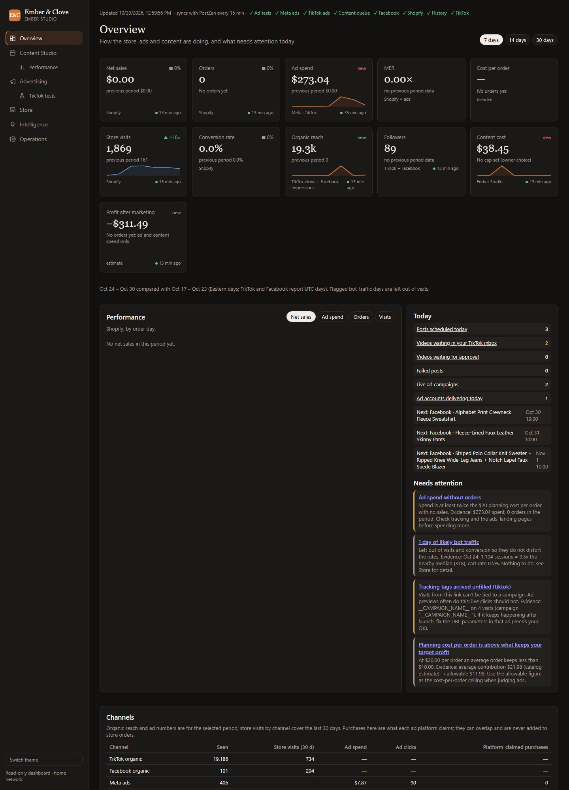
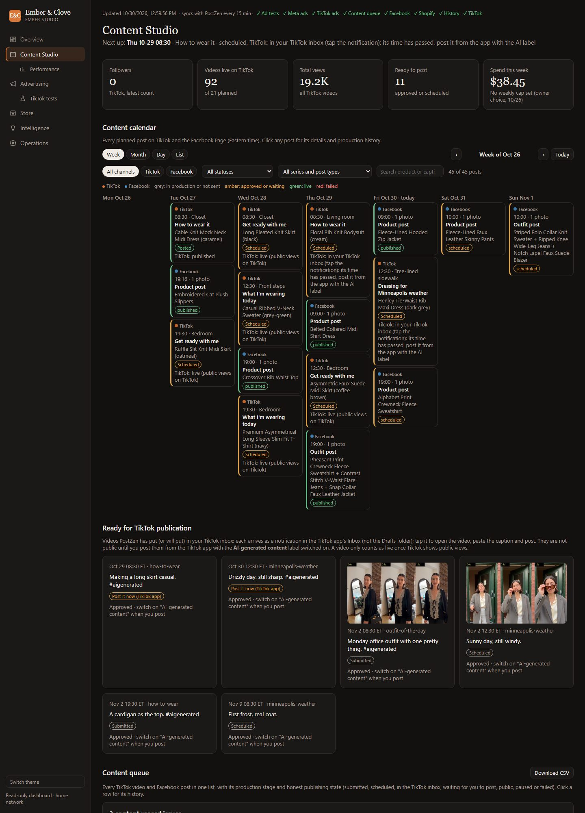
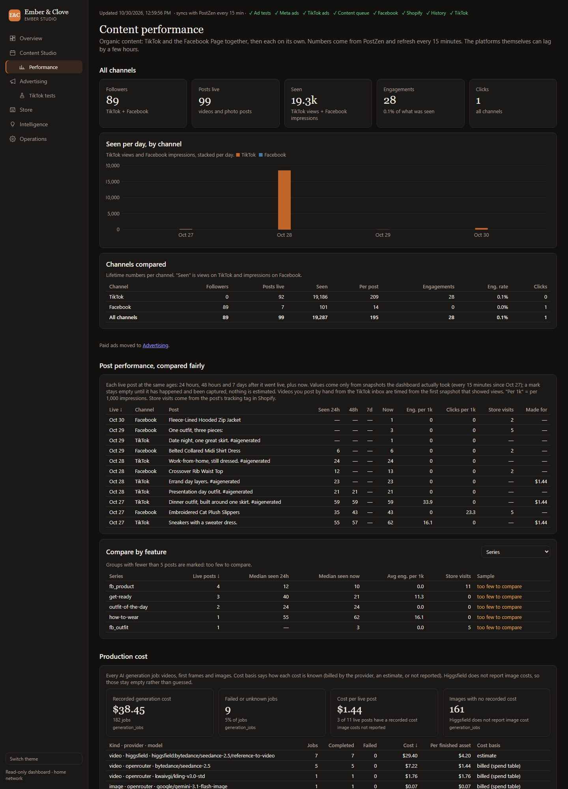
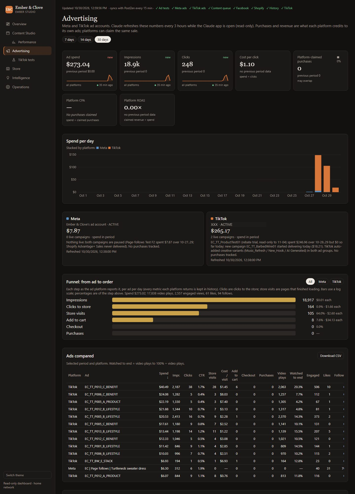
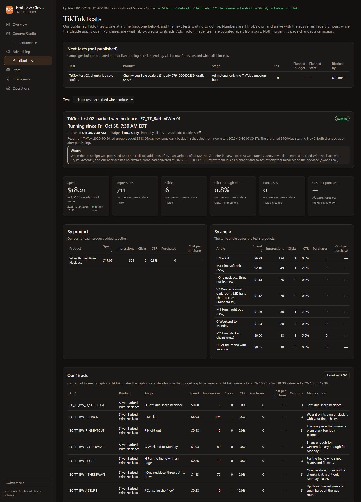
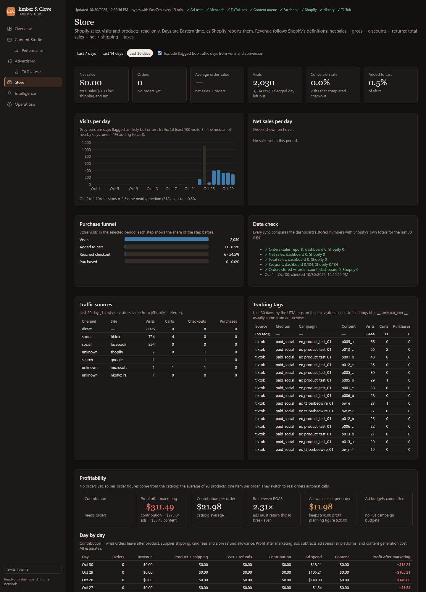
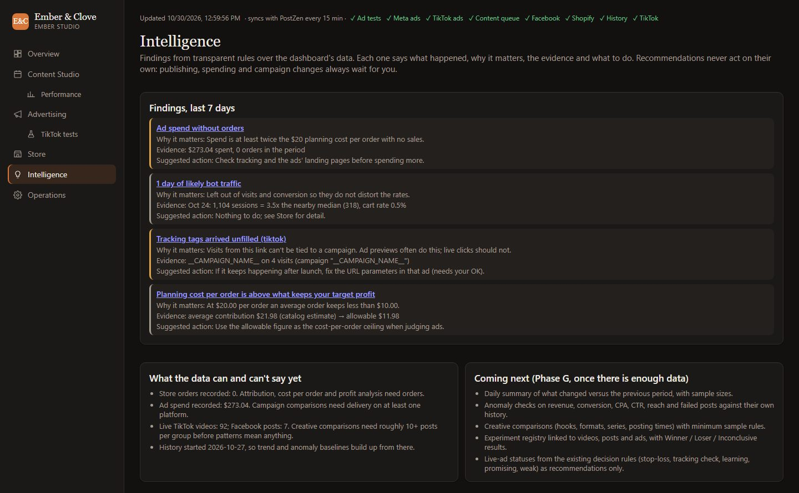
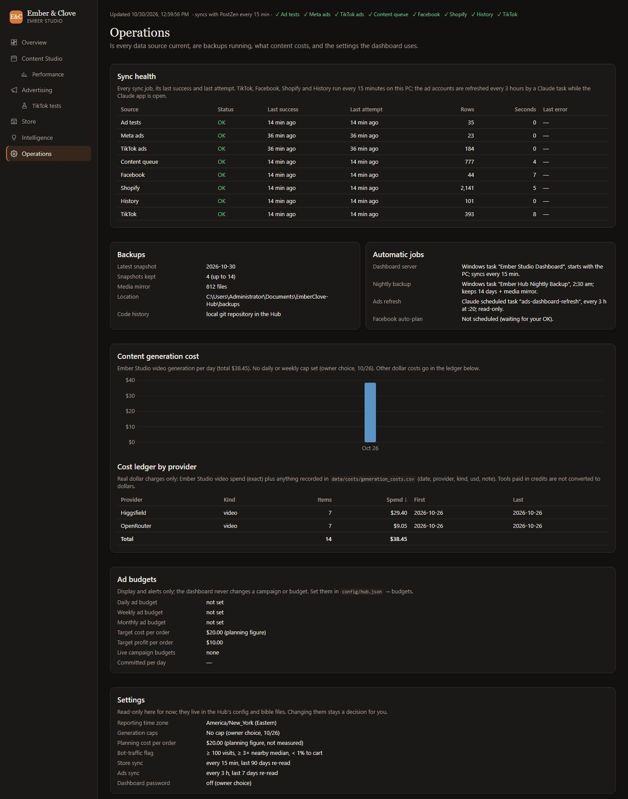

# Dashboard tour

A page-by-page walk through the Ember Studio dashboard, with screenshots taken on 2026-10-30. The dashboard runs on
this PC (Windows task "Ember Studio Dashboard", port 8790) and is reachable only on the home network. It is
**read-only**: nothing on it publishes, spends or changes a campaign or the store. How to run, check and fix it:
`DASHBOARD_OPERATIONS.md`.

**On every page**
- **Left menu:** the eight pages below. "Switch theme" toggles light and dark.
- **Top line:** when the data was last updated, and a green tick per data source (Ad tests, Meta ads, TikTok ads,
  Content queue, Facebook, Shopify, History, TikTok). A red mark means that sync failed; see Operations.
- **Cards:** a number, what it is compared with (the previous period of the same length), where it comes from and how
  old it is. A small line chart shows the trend.

The screenshots are real data; the TikTok ad account's company name is blacked out.

---

## 1. Overview

The one-page answer to "how is the business doing and what needs me today".

- **Period buttons** (7 / 14 / 30 days), top right: every card and chart uses the chosen period.
- **Top cards:** net sales, orders, ad spend, MER (sales ÷ ad spend), cost per order, store visits, conversion rate,
  organic reach (TikTok views + Facebook impressions), followers, content cost and **profit after marketing**
  (what orders leave after product, shipping and fees, minus ad and content spend).
- **Performance chart:** net sales, ad spend, orders or visits per day (pick with the buttons).
- **Today:** posts scheduled today, videos waiting in your TikTok inbox or for your approval, failed posts, live ad
  campaigns and the next scheduled posts. Each line links to the page that has the detail.
- **Needs attention:** findings from the Intelligence rules, such as ad spend without orders, a day of bot traffic,
  ad links with unfilled tracking tags, or a cost-per-order target above what keeps your profit target.
- **Channels:** TikTok organic, Facebook organic, Meta ads and TikTok ads side by side: how often seen, store
  visits, ad spend, clicks and the purchases each platform claims.

## 2. Content Studio

Everything the AI character account posts on TikTok and the Facebook Page.

- **Next up** (under the title): the next post and what it needs from you.
- **Cards:** followers, videos live on TikTok, total views, posts ready to go out, and this week's generation spend.
- **Content calendar:** every planned post by week, month, day or list, filterable by channel, status and series.
  Colour shows the state: grey = in production, amber = approved or waiting, green = live, red = failed. Click a
  post for its details and production history.
- **Ready for TikTok publication:** videos PostZen put in your TikTok inbox. Each arrives as a notification in the
  TikTok app; you open it, paste the caption and post it with the **AI-generated content** label switched on. It
  only counts as live once TikTok shows public views.
- **Content queue** (further down): every video and post in one list with its production stage and honest
  publishing state, plus a CSV download.

## 3. Content performance

How the organic (unpaid) posts are doing, TikTok and Facebook together and apart.

- **Cards:** followers, posts live, times seen, engagements, clicks.
- **Seen per day, by channel:** TikTok views and Facebook impressions stacked per day.
- **Channels compared:** lifetime numbers per channel, including views per post and engagement rate.
- **Post performance, compared fairly:** each post at the same ages (24 h, 48 h, 7 days, now) so old and new posts
  can be compared. Values come only from snapshots the dashboard actually took; nothing is estimated.
- **Compare by feature:** results grouped by series (or another feature you pick). Groups under 5 posts are marked
  "too few to compare".
- **Production cost:** every AI generation job with its provider, model, cost and how the cost is known (billed,
  estimate or not reported).

## 4. Advertising

The paid ads on Meta and TikTok. Claude refreshes these every 3 hours while the Claude app is open (read-only).

- **Cards:** ad spend, impressions, clicks, cost per click, purchases the platforms claim, platform CPA and ROAS.
  Platforms can claim the same sale, so these are never added to store orders.
- **Spend per day:** stacked by platform.
- **Meta / TikTok boxes:** each account's status, spend in the period, live campaigns and a short note on what is
  running or paused.
- **Funnel: from ad to order:** impressions → clicks to store → store visits → add to cart → checkout → purchases,
  with the cost of each step. Shows where people drop off.
- **Ads compared:** every ad with spend, impressions, clicks, CTR, store visits, cost per visit, carts, purchases and
  video watch-through, plus a CSV download.

## 5. TikTok tests

One TikTok product test at a time (pick it from the **Test** menu).

- **Next tests (not published):** tests built or prepared but not live, and what still blocks each one. Nothing
  there is spending.
- **Test header:** campaign name, when it started, budget, and a **Watch** box for anything you should review
  (for example ad variants TikTok added on its own).
- **Cards:** spend, impressions, clicks, click-through rate, purchases and cost per purchase.
- **By product / By angle:** the same ads added up per product and per creative angle, to see which idea works.
- **Our ads:** every ad in the test with its angle, numbers and main caption. Click an ad to see all its captions.

## 6. Store

Shopify sales, visits and products, read-only, in Eastern days and Shopify's own definitions.

- **Cards:** net sales, orders, average order value, visits, conversion rate and add-to-cart rate. The tick box
  leaves flagged bot-traffic days out of visits and conversion.
- **Visits per day / Net sales per day:** grey bars are days flagged as likely bot or test traffic.
- **Purchase funnel:** visits → added to cart → reached checkout → purchased.
- **Data check:** each sync compares the dashboard's numbers with Shopify's own totals; green ticks mean they match.
- **Traffic sources / Tracking tags:** where visitors came from, and which ad links (UTM tags) brought them.
- **Profitability:** contribution, profit after marketing, contribution per order, break-even ROAS and the
  allowable cost per order that still keeps your target profit. Until there are orders these use the catalog
  average. **Day by day** below lists the same per day.

## 7. Intelligence

Plain rules run over the dashboard's data. Each finding says what happened, why it matters, the evidence and a
suggested action. Nothing here acts on its own: publishing, spending and campaign changes always wait for you.

- **Findings, last 7 days:** the same items as "Needs attention" on the Overview, in full.
- **What the data can and can't say yet:** how much data there is, and which comparisons need more.
- **Coming next:** checks that switch on once there is enough history.

## 8. Operations

Is the system healthy, and what settings it uses.

- **Sync health:** each data source with its status, last success, last attempt, rows and any error. This is the
  first place to look if a number seems stale.
- **Backups:** latest nightly snapshot, how many are kept and where. **Automatic jobs:** what runs on its own and
  when.
- **Content generation cost:** AI generation spend per day and a ledger by provider.
- **Ad budgets / Settings:** the budgets and targets the dashboard checks against (display and alerts only) and the
  settings it reads from the Hub's config. Changing them is your decision.

---

To refresh the screenshots, capture each page at 1440 px wide (for example with headless Chrome), black out anything
private (account names, emails, IDs) and replace the files in `docs/gui/`. Images are not redacted by
`scripts/publish_public.py`, so check them by eye before committing.
